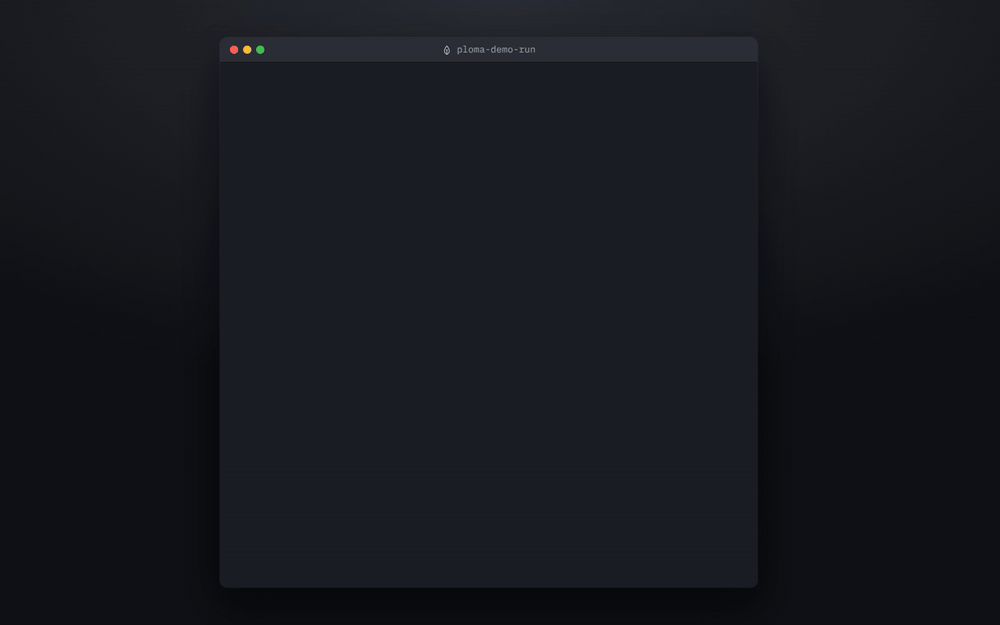
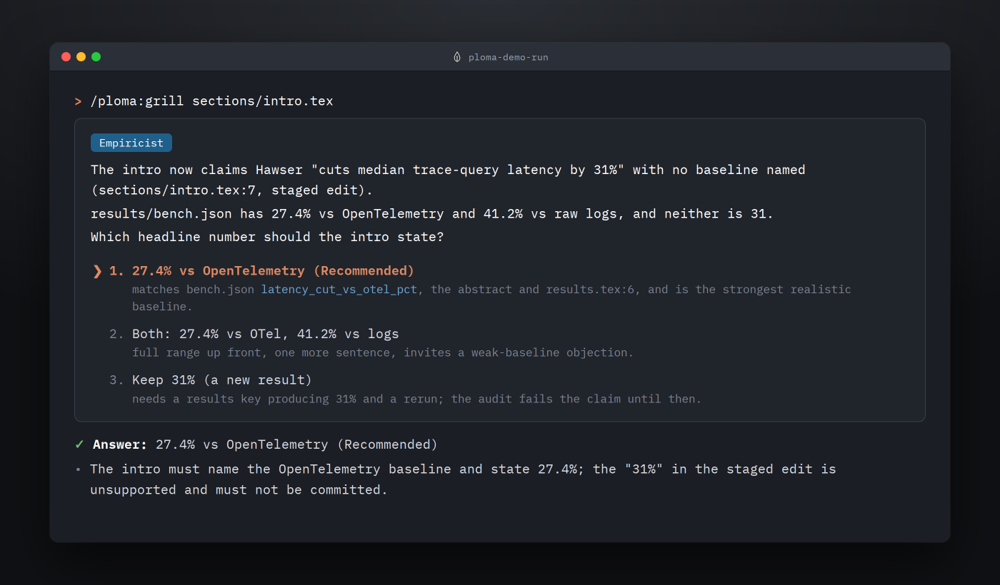
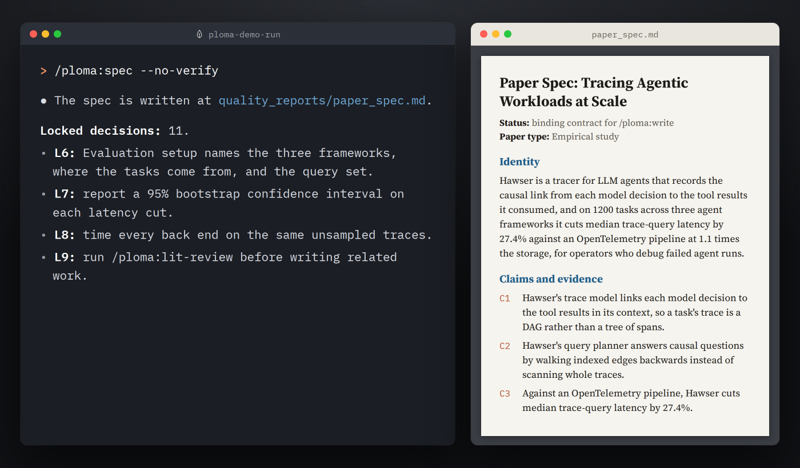
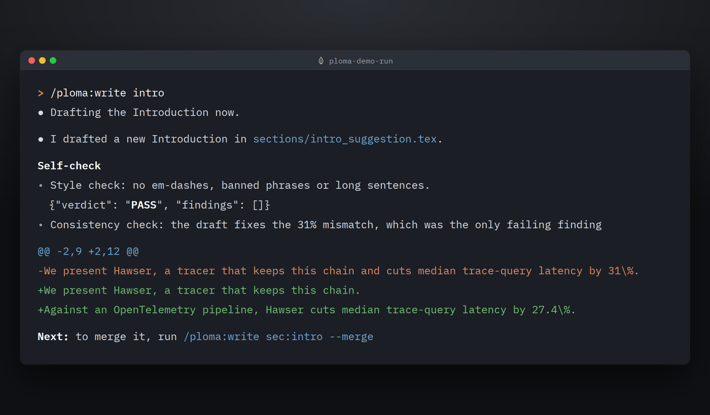
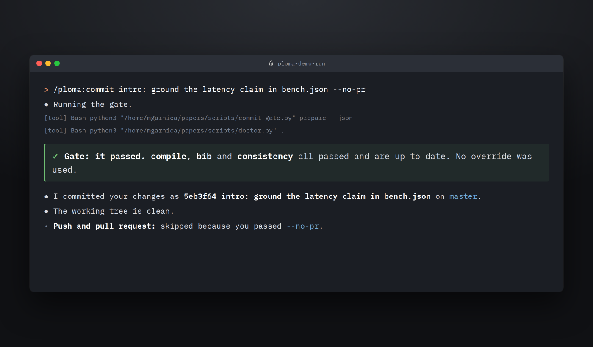

  <picture>
    <source media="(prefers-color-scheme: dark)" srcset="assets/logo/ploma-lockup-dark.svg">
    
  </picture>

<strong>A research co-author for Claude Code and Codex.</strong> It grills your idea, grounds every claim in your results and your references, and refuses to commit what it cannot check.

<em>Your paper. Your claims. Checked.</em>

  
  
  
  
  

<a href="#install-in-two-minutes">Install</a> · <a href="#how-a-paper-gets-written">See the workflow</a>

Grill, write, merge, compile and commit on one paper. The paper is a fictional demo that ships in [`examples/demo-paper`](examples/demo-paper), so you can replay this session. Every terminal line in the film comes from a real ploma session; the transcripts are in [`media/transcripts/`](media/transcripts/). [Watch the MP4](assets/film/ploma-hero.mp4).

## Why ploma exists

A coding agent can write a fluent introduction. The demo paper's introduction says its tracer, Hawser, cuts median trace-query latency by 31%. Its results file, `results/bench.json`, says 27.4%. The prose reads well either way.

A paper needs every number to trace back to a result and every citation to a real record. A referee who reruns the benchmark should find the number the text states, and every entry in `refs.bib` should resolve to a published work.

ploma makes the agent earn each sentence. It asks about the 31% before it drafts anything, the draft pins the number to `bench.json`, and `/ploma:commit` refuses to commit until the required checks pass on the current files.

## How a paper gets written

### Grill

Grill closes the open design decisions, one question at a time, each with a recommended answer and its reason. It reads the repo before it asks: here it found 31% in the intro, 27.4% and 41.2% in `results/bench.json`, and asked which number the intro should state.

### Spec

Spec turns the answers into `quality_reports/paper_spec.md`, the binding contract that `/ploma:write` drafts against: claims, evidence, venue constraints, page targets and locked decisions. On the demo paper it locked 11 decisions.

### Write

Write drafts the section into a `_suggestion.tex` file beside the original and checks it before you read it. Here the draft replaced the unsupported 31% with 27.4% against the OpenTelemetry baseline. The manuscript changes only when you run `/ploma:write intro --merge` and answer yes.

### Ship

`/ploma:commit` commits only when the required checks pass on the current files. On the demo paper compile, bib and consistency passed with no override, and the commit landed. An override needs a written reason, and the reason is logged.

## What stops slop

- `/ploma:verify-claims` checks each factual claim with Chain-of-Verification; the verifier works in a fresh context and never sees the draft.
- `/ploma:audit-reproducibility` matches every reported number against the pipeline's results files within the configured tolerances.
- `/ploma:validate-bib --semantic` checks that each cited entry exists on Crossref, DataCite, OpenAlex or Semantic Scholar.
- `/ploma:review` writes a referee-style review, with `--peer`, `--adversarial` and `--seven-pass` modes.
- `/ploma:devils-advocate` asks 5 to 7 sceptical questions about your design choices and changes nothing.
- `/ploma:proofread` reports problems and fixes them only after you approve.

## Install in two minutes

| Claude Code | Codex |
|---|---|
| `/plugin marketplace add marcgarnica13/ploma` | `codex plugin marketplace add marcgarnica13/ploma` |
| `/plugin install ploma@ploma` | `codex plugin add ploma@ploma` |
| `/ploma:onboard` | `$ploma:onboard` |

Onboard reads the repo, proposes `ploma.yaml` and the project files, and writes them only after you approve. On Codex, open `/hooks` in the Codex TUI and trust ploma's hooks before you run onboard, and type skills as `$ploma:<name>`.

[`docs/install.md`](docs/install.md) covers HTTPS without SSH keys, updates and API keys. [`docs/hosts.md`](docs/hosts.md) covers switching hosts and co-authors on Codex.

## The full lifecycle

ploma covers a LaTeX paper from the first idea to the response to referees. The paper repo declares its facts once in `ploma.yaml` (manuscript path, build command, venue). Skills, agents, hooks and rules read that config instead of restating it. Each stage is owned by one skill, and `/ploma:status` recommends the next one from state that survives sessions. `/ploma:doctor` says whether the repo is ready.

| # | Stage | Skill |
|---|---|---|
| 0 | Install | `/ploma:onboard` |
| 0b | Health | `/ploma:doctor` |
| 1 | Brainstorm | `/ploma:brainstorm` |
| 1b | Literature | `/ploma:lit-review` |
| 2 | Grill | `/ploma:grill` |
| 3 | Spec | `/ploma:spec` |
| 4 | Write | `/ploma:write <section>` |
| 5 | Compile | `/ploma:compile` |
| 5b | Format | `/ploma:format` |
| 6 | Validate | `/ploma:validate-bib`, `/ploma:verify-claims`, `/ploma:audit-reproducibility`, `/ploma:proofread` |
| 7 | Review | `/ploma:review`, `/ploma:devils-advocate` |
| 8 | Respond | `/ploma:respond <report>` |
| 9 | Ship | `/ploma:commit` |
| any | Session | `/ploma:status`, `/ploma:checkpoint`, `/ploma:compress-session`, `/ploma:learn`, `/ploma:deep-audit`, `/ploma:help` |

All 23 skills

- `/ploma:onboard`: detect the repo's facts, propose `ploma.yaml` and project files, write after approval.
- `/ploma:doctor`: read-only readiness check with a verdict.
- `/ploma:brainstorm`: 3 to 5 research questions with hypotheses, methods and pitfalls, fact-checked.
- `/ploma:lit-review`: literature search and synthesis; BibTeX offered only after a citation lookup.
- `/ploma:grill`: one question per turn with a recommended answer until no design decision is open.
- `/ploma:spec`: the binding paper spec (claims, evidence, venue constraints, page targets, decisions).
- `/ploma:write`: draft a section into a `_suggestion.tex` sibling; merges only on `--merge` and your yes.
- `/ploma:compile`: build the PDF, triage the log, check pages against the budget.
- `/ploma:format`: page map per section against the budget, a cut plan, pre-submission checks.
- `/ploma:validate-bib`: structural bibliography check; `--semantic` verifies entries against citation APIs.
- `/ploma:verify-claims`: fact-check claims with a fresh-context verifier (Chain-of-Verification).
- `/ploma:audit-reproducibility`: match reported numbers against the pipeline's results within tolerances.
- `/ploma:proofread`: report-only proofreading; fixes only after approval.
- `/ploma:review`: referee-style review; `--peer`, `--adversarial` and `--seven-pass` modes.
- `/ploma:devils-advocate`: 5 to 7 skeptical challenges to design choices; report only.
- `/ploma:respond`: point-by-point response to referee reports, locations fact-checked.
- `/ploma:commit`: commit behind the gate; asks before any push or pull request.
- `/ploma:status`: stage, gate, plan and session log on one screen.
- `/ploma:checkpoint`: structured snapshot of plan, decisions, pointers and next actions.
- `/ploma:compress-session`: distil the session into a note before auto-compaction.
- `/ploma:learn`: append a learning to the ledger; promote approved entries to a rule.
- `/ploma:deep-audit`: audit the ploma installation for drift and dangling references; fixes after approval.
- `/ploma:help`: what ploma is and which skill owns which stage.

Hooks (session context, pre-compact snapshot, context monitor, verify and log reminders) are silent in a repo without `ploma.yaml`. Venue profiles live in `venues/`, discipline profiles in `disciplines/`, both overridable per project in `ploma.d/`.

## Trust and testing

ploma 0.2.0 was released on 2026-10-30. The suite has 1464 tests and CI runs it on Python 3.10 and 3.12. The maintainers also run skills headless on real paper repos, on both hosts, and pass a skill when its verdict matches what a careful author would conclude. They run no billed evals. [`docs/testing.md`](docs/testing.md) has the commands.

- [`docs/commit-gate.md`](docs/commit-gate.md): the required and recommended checks, the override syntax and the limit of three overrides in a row.
- [`docs/hosts.md`](docs/hosts.md): one host at a time, and what the doctor reports after a switch.
- [`CHANGELOG.md`](CHANGELOG.md): every release and its known issues.
- [`docs/superpowers/specs/`](docs/superpowers/specs/): the design specs.

## Credits and licence

ploma is licensed under Apache-2.0; see [`LICENSE`](LICENSE). The projects it took ideas, structure or text from are listed in [`UPSTREAMS.md`](UPSTREAMS.md). The hero film is rendered with [HyperFrames](https://github.com/heygen-com/hyperframes) (Apache-2.0). The wordmark is set in Fraunces (SIL Open Font License) and converted to outlines, so no font file ships.
